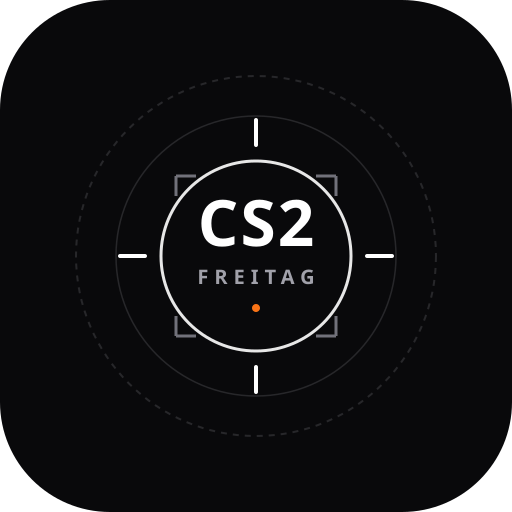
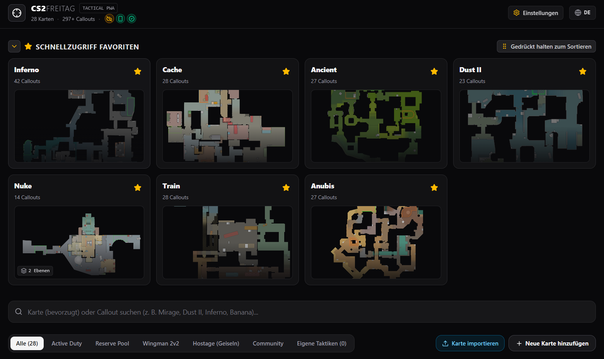
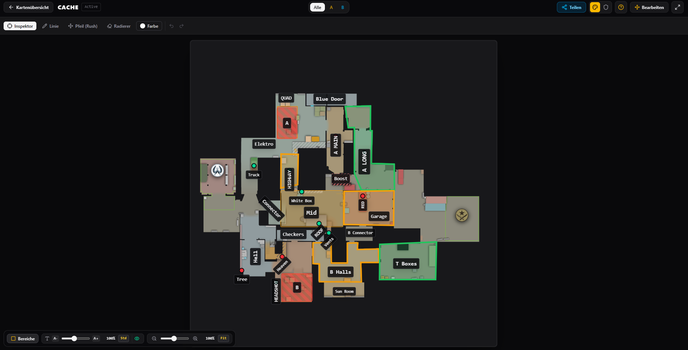
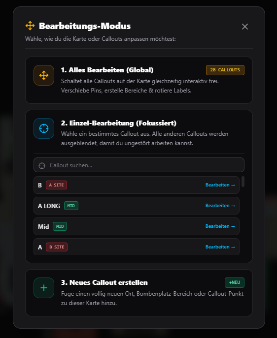
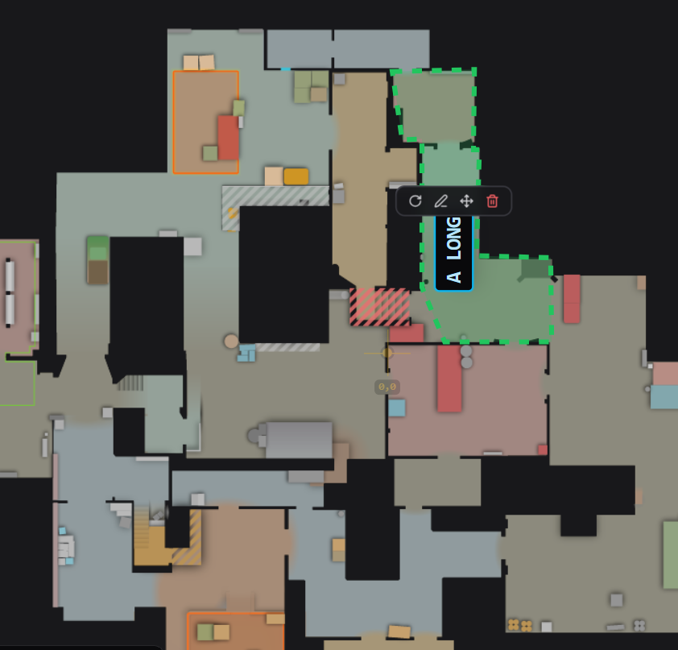
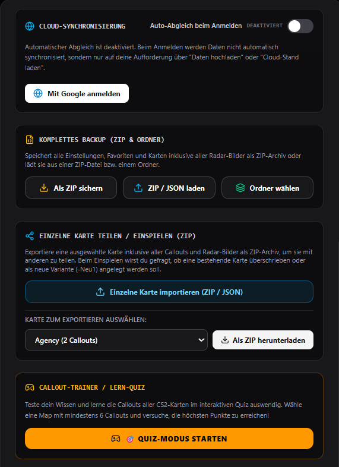
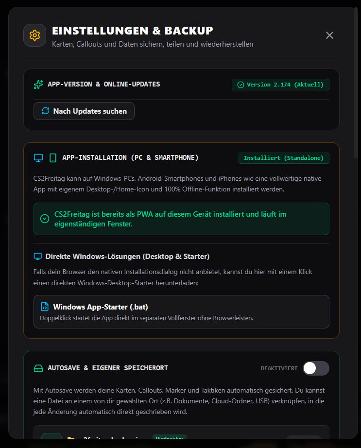

<div align="center">
  
</div>


# CS2Freitag – Tactics & Map Hub

Flexibly customize, create, and easily share map callouts.

* **➔ Open App in Browser:** [cs2freitag.github.io/app/](https://github.io)

---

## 🚀 Key Features & Impressionen

### 🗺️ 1. Interaktiver Map & Callout Hub
Wähle aus über 28 detailgetreuen Counter-Strike 2 Karten deine Wunsch-Map aus. Das Dashboard bietet dir schnellen Zugriff auf deine Favoriten und zeigt dir direkt an, wie viele Callouts bereits hinterlegt sind.

<div align="center">
  
</div>

### ✍️ 2. Taktik-Editor & Zeichentool
Nutze professionelle Strategie-Werkzeuge direkt auf dem Radar. Zeichne präzise Laufwege, erstelle Linien, setze Pfeile für Rushes oder nutze den Radierer, um deine Pläne im Team abzustimmen.

<div align="center">
  
</div>

### 🛠️ 3. Flexibler Bearbeitungs-Modus
Passe die Benennungen vollständig nach deinen Wünschen an. Du kannst entscheiden, ob du alle Callouts auf der Karte gleichzeitig bearbeitest, dich fokussiert auf ein einzelnes Callout konzentriererst oder ein komplett neues Callout hinzufügst.

<div align="center">
  
</div>

### 📐 4. Eigene Bereiche & Labels erstellen
Verschiebe Pins frei Hand, rotiere Labels für eine perfekte Lesbarkeit oder ziehe passgenaue, farbige Zonen (wie hier für "A LONG") auf dem Radar, um Callout-Grenzen exakt zu definieren.

<div align="center">
  
</div>

### 🧠 5. Callout-Trainer & Backup-Verwaltung
Lerne die Callouts spielerisch im interaktiven Quiz-Modus auswendig. Deine erstellten Daten kannst du bequem als komplettes ZIP-Archiv sichern, hochladen oder einzelne Karten gezielt exportieren, um sie mit deinen Mates zu teilen.

<div align="center">
  
</div>

### 📱 6. Vollwertige App-Installation (PWA)
CS2Freitag läuft dank modernster Progressive Web App Technologie nativ in einem eigenständigen Fenster auf Windows-PCs, Android-Smartphones und iPhones – inklusive 100% Offline-Funktionalität und automatischen Updates.

<div align="center">
  
</div>

---

## Run Locally

This contains everything you need to run the **CS2Freitag** app locally.

**Prerequisites:** Node.js

1. **Install dependencies:**
   ```bash
   npm install
   ```

2. **Run the app:**
   ```bash
   npm run dev
   ```
